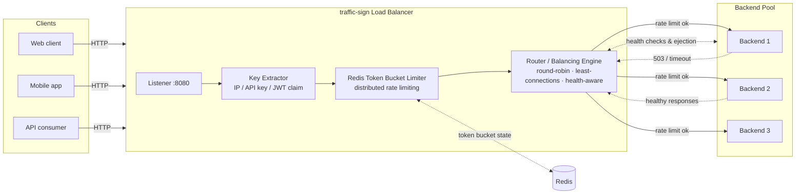

# Traffic Sign 🚦

[](https://go.dev/)
[](https://redis.io/)
[](https://www.docker.com/)
[](#continuous-integration)
[](LICENSE)

**Traffic Sign** is a **High-Performance HTTP Load Balancer & Traffic Management Gateway** with **built-in distributed token-bucket rate limiting, reverse proxying, backend routing, traffic shaping, and health checks**.

> **Traffic Sign is a Load Balancer / Reverse Proxy Gateway** — not an application server. It sits in front of your upstream backend pool, forwards HTTP requests over fast HTTP transports, enforces per-client and global rate limits across all gateway instances with a Redis-backed distributed token bucket, and continuously health-checks backends so traffic only reaches healthy upstreams.

## Contents

- [Why traffic-sign](#why-traffic-sign)
- [Features](#features)
- [Architecture](#architecture)
- [Quick start](#quick-start)
- [CLI usage](#cli-usage)
- [Go example](#go-example)
- [Rate limiting & traffic shaping](#rate-limiting--traffic-shaping)
- [Development](#development)
- [License](#license)

## Why traffic-sign

| Capability | What it means in practice |
| --- | --- |
| Load balancing | Round-robin, weighted round-robin, least-connections, and IP-hash balancing across an upstream backend pool. |
| Reverse proxy | Transparent HTTP/1.1 and HTTP/2 proxying with header forwarding, X-Forwarded-*, retries, and timeouts. |
| Distributed rate limiting | Token-bucket algorithm backed by Redis, so limits are shared and consistent across every gateway replica. |
| Traffic shaping | Per-route/per-client request budgets, burst allowances, queuing, and throttling policies. |
| Health checks | Active and passive checks; unhealthy backends are ejected automatically and recovered when they pass. |

## Features

- High-throughput, low-latency Go implementation with efficient connection reuse.
- Listener with graceful shutdown, connection limits, and keep-alive tuning.
- Key extractor: client IP, API key, JWT claim, or custom header for per-client limiting.
- Redis token-bucket limiter: `INCR`/`EXPIRE` or Lua-scripted buckets for accuracy under concurrency.
- Router / balancing engine with path, host, and header-based routing rules.
- Active health checks (HTTP probes) plus passive failure detection with cooldown ejection.
- Traffic shaping: burst capacity, refill rate, per-route priorities, and retry budgets.
- Hot-reloadable YAML configuration and structured JSON logging.

## Architecture



Request flow:

1. The **Listener** accepts the connection and parses the request.
2. The **Key Extractor** derives a stable client identity (IP, API key, or token claim).
3. The **Redis Token Bucket Limiter** checks/consumes a token for that key — atomically, via Lua, so all gateway replicas share one budget.
4. If allowed, the **Router / Balancing Engine** picks a healthy backend (round-robin, least-connections, weighted, or IP-hash) and proxies the request.
5. Health checks run in the background; failing backends are removed from rotation until they recover.


## Quick start

### With Docker Compose

```bash
git clone <your-repository-url> traffic-sign
cd traffic-sign
docker compose up --build -d

# Watch the balancer distribute across the backend pool
for i in $(seq 1 10); do curl -s http://localhost:8080/ | grep Hostname; done
```

### From source

```bash
go build -o traffic-sign ./cmd/traffic-sign
./traffic-sign --config traffic-sign.yml
```

### Verify

```bash
curl -i http://localhost:8080/health      # gateway health
curl -i http://localhost:8080/            # proxied to a backend
# Hammer it to see 429 responses once the token bucket empties:
# hey -n 1000 -c 50 http://localhost:8080/
```

## Go example

Embed traffic-sign's limiter and balancer in your own Go service:

```go
package main

import (
	"log"
	"net/http"
	"time"

	"github.com/your-org/traffic-sign/limiter"
	"github.com/your-org/traffic-sign/proxy"
)

func main() {
	// Distributed token-bucket rate limiter backed by Redis
	rl, err := limiter.NewRedisTokenBucket(limiter.Options{
		RedisAddr:         "localhost:6379",
		RequestsPerSecond: 50,
		Burst:             100,
		KeyFunc:           limiter.ClientIPKey,
	})
	if err != nil {
		log.Fatalf("limiter: %v", err)
	}
	defer rl.Close()

	// Backend pool with health-aware load balancing
	balancer, err := proxy.NewBalancer(proxy.Config{
		Algorithm:        proxy.RoundRobin,
		Backends: []string{
			"http://localhost:9001",
			"http://localhost:9002",
			"http://localhost:9003",
		},
		HealthCheckInterval: 5 * time.Second,
		HealthCheckPath:     "/health",
	})
	if err != nil {
		log.Fatalf("balancer: %v", err)
	}

	handler := http.HandlerFunc(func(w http.ResponseWriter, r *http.Request) {
		allowed, retryAfter := rl.Allow(r)
		if !allowed {
			w.Header().Set("Retry-After", retryAfter.String())
			http.Error(w, "rate limit exceeded", http.StatusTooManyRequests)
			return
		}
		balancer.ServeHTTP(w, r) // proxy to a healthy backend
	})

	log.Println("traffic-sign gateway listening on :8080")
	log.Fatal(http.ListenAndServe(":8080", handler))
}
```

## Rate limiting & traffic shaping

- **Token bucket** — each client key holds a bucket of `burst` tokens refilled at `requests_per_second`; empty bucket ⇒ `429 Too Many Requests` with `Retry-After`.
- **Distributed by design** — bucket state lives in Redis, so N gateway replicas enforce one shared limit with no drift.
- **Traffic shaping** — shape per route (`/api/` tighter, `/public/` looser), add burst capacity for spiky clients, and use connection/idle timeouts to keep queues bounded.
- **Observability** — `X-RateLimit-Limit`, `X-RateLimit-Remaining` response headers, plus structured logs per decision.

## Development

```bash
git clone <your-repository-url> traffic-sign
cd traffic-sign

go mod download
go test ./... -race        # unit tests
gofmt -l . && go vet ./... # lint

docker compose up --build -d  # full stack: Redis + LB + 3 backends
```

Guidelines:

- Keep the limiter, key extractor, router, and health checker as separate, testable packages.
- Add tests for any change to balancing or limiting semantics; use `miniredis` for limiter tests.
- Update this README and example YAML configs when adding configuration keys.
- Never commit secrets, real Redis credentials, or production configs.

## License

Distributed under the MIT License. See [`LICENSE`](LICENSE) for details.

# This Shit Developed By MOHSEN
